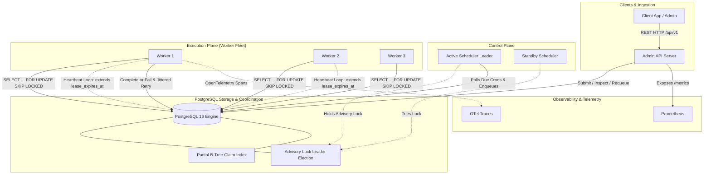

# Distributed Job Scheduler (Go 1.22+ & PostgreSQL)

A durable, multi-worker distributed job execution system engineered in Go with leases, heartbeats, exponential backoff with full jitter, cron scheduling, and a dead-letter queue (DLQ) backed by PostgreSQL.

---

## Architecture Overview



---

## Core Design Principles & Guarantees

### 1. Delivery Semantics: At-Least-Once Execution
> **CRITICAL ARCHITECTURAL GUARANTEE:**
> This system guarantees **at-least-once execution**. We explicitly **do NOT claim exactly-once execution**, because distributed systems physical reality (network partitions, abrupt worker crashes after side-effect execution but before database commit) makes exactly-once impossible without 2-phase commits across all external side-effects.

#### What IS Guaranteed:
1. **Zero lost jobs:** A job in PostgreSQL is guaranteed to eventually execute unless explicitly cancelled. If a worker panics or its host machine abruptly loses power, its lease will expire in PostgreSQL and another worker will automatically reclaim it.
2. **Mutual exclusion under normal operation:** Two workers will never execute the same job simultaneously under active leases.
3. **Idempotent job submissions:** Jobs submitted with an `idempotency_key` are protected by a unique index (`idx_jobs_idempotency_key`). Concurrent submissions of the same key will never produce duplicate queue entries.
4. **Finite retries with quarantine:** Poison jobs will retry up to `max_attempts` with exponential backoff and full jitter, then move to `dead_letter` without blocking subsequent jobs.

#### What is NOT Guaranteed (and How Workers Must Handle It):
If a worker charges a customer's credit card or sends an SMS, and the worker process suffers a kernel panic 1 millisecond before calling `CompleteJob`, PostgreSQL will notice the lease expire and give the job to another worker. **The worker's execution logic must be idempotent** (e.g. passing the job's `idempotency_key` or `ID` down to the payment gateway or database).

---

## Engineering Challenges Addressed Explicitly

### 1. Clock Skew and the Authoritative Database Clock
- **The Challenge:** Distributed worker nodes and cloud VMs suffer from NTP drift, hypervisor clock skew, and leap second shifts. If worker nodes use their local `time.Now()` to calculate whether a lease is valid, Worker A could consider its lease active while Worker B's clock is 500ms ahead, claiming the job prematurely and executing concurrently.
- **The Solution:** We make PostgreSQL the **sole arbiter of time**.
  - All claims, heartbeats, retry backoffs, and run timestamps are computed using PostgreSQL's server clock `NOW()`:
    ```sql
    -- Atomic claim with database time
    UPDATE jobs
    SET state = 'running',
        claimed_by = $2,
        lease_expires_at = NOW() + ($3 * INTERVAL '1 second')
    WHERE id = next_job.id;
    ```
  - Worker host system clocks are never trusted for lease correctness.

### 2. Race Conditions: Claim, Heartbeat, and Lease Expiry
- When a worker's heartbeat arrives at the database:
  ```sql
  UPDATE jobs
  SET lease_expires_at = NOW() + ($3 * INTERVAL '1 second'),
      updated_at = NOW()
  WHERE id = $1
    AND claimed_by = $2
    AND state = 'running'
    AND lease_expires_at > NOW();
  ```
- If the lease already expired in PostgreSQL and another worker claimed it, `claimed_by = $2` fails. The query returns **0 rows updated**.
- The worker receives `domain.ErrLeaseLost`. The worker immediately cancels the job's `context.Context`, aborting all in-flight work and preventing zombie writes.

### 3. Transaction Boundaries & Result Commit
- Worker execution and database state updates are decoupled:
  1. Worker executes business logic.
  2. If business logic succeeds, worker calls `CompleteJob` in an atomic transaction storing the JSON result and clearing `lease_expires_at`.
  3. If worker crashes before `CompleteJob`, the transaction is rolled back; the lease expires, and the next attempt re-executes cleanly.

### 4. Goroutine Lifecycle, Context Cancellation & Leak Prevention
- Workers manage concurrency using bounded worker pools with strict `sync.WaitGroup` and `context.Context` propagation:
  - Each job receives a child context with `context.WithCancel(parentCtx)`.
  - The heartbeat loop runs in a dedicated goroutine and exits deterministically on `jobCtx.Done()` or explicit channel close (`close(hbDone)`).
  - On `SIGTERM` / graceful shutdown, workers stop polling the queue, allow in-flight tasks up to a grace period to complete, and call `ReleaseJob` on remaining tasks so peer workers can claim them immediately.

### 5. Poison Jobs, Retry Storms & Thundering Herds
- **Poison jobs:** Handlers are guarded with `defer func() { if r := recover(); ... }` to catch panics and record the stack trace. The job is marked failed, its attempt count is incremented, and after `max_attempts` it moves to `dead_letter`.
- **Thundering Herds:** Retries use **Full Jitter** ($U(0, \min(M, B \times 2^a))$):
  ```go
  backoffCap := math.Min(maxBackoff, baseBackoff*math.Pow(2, float64(job.Attempt-1)))
  jitteredDelaySeconds := int(rand.Float64() * backoffCap)
  ```
  This decorrelates retries across hundreds of simultaneous failures, smoothing traffic to downstream dependencies.

---

## 8 Workflow Milestones

| Milestone | Description | Key Components |
| :--- | :--- | :--- |
| **1. Schema + Submit/Inspect API** | Durable tables, partial unique index for idempotency, REST admin endpoints. | `migrations/000001_create_jobs_table.up.sql`, `internal/api/router.go` |
| **2. Claim with SKIP LOCKED & Leases** | Atomic visibility lease claiming via `SELECT FOR UPDATE SKIP LOCKED`. | `internal/store/postgres.go` (`ClaimJob`) |
| **3. Workers + Heartbeats** | Goroutine pool, cancellation context, background heartbeat pings. | `internal/worker/worker.go`, `internal/grpc/service.go` |
| **4. Retries & Dead-Letter Queue** | Exponential backoff with full jitter, DLQ state, requeue endpoint. | `FailJob`, `RequeueDeadLetter`, `docs/ARCHITECTURE.md` |
| **5. Cron & Leader Election** | PostgreSQL advisory locks (`pg_try_advisory_lock`), 5-field cron parser. | `internal/scheduler/scheduler.go`, `internal/cron/parser.go` |
| **6. Fairness & Priorities** | Priority-ordered claiming (`priority DESC, run_at ASC`), tenant quotas. | `idx_jobs_claimable`, `queue_configs` |
| **7. Observability** | Prometheus metrics (durations, claim latencies, DLQ counts) + OpenTelemetry. | `internal/telemetry/metrics.go`, `/metrics` |
| **8. Chaos & Load Testing** | Worker kill simulation mid-job, concurrency proof, 10k-job load benchmark. | `tests/integration/`, `tests/fuzz/`, `cmd/loadtest/` |

---

## Quickstart & Run Instructions

### 1. Prerequisites
- Docker & Docker Compose
- Go 1.22+

### 2. Run with Docker Compose
```bash
# Launch PostgreSQL 16, auto-apply migrations, start server & 2 workers, plus Prometheus
docker compose up -d --build

# View server logs
docker compose logs -f server

# View Prometheus at http://localhost:9090
# View HTTP Admin API at http://localhost:8080
```

### 3. Run Manually (Local Go Dev)
```bash
# Start Postgres
docker run -d --name test-postgres -e POSTGRES_PASSWORD=postgrespassword -e POSTGRES_DB=scheduler -p 5432:5432 postgres:16-alpine

# Apply migrations
make migrate-up

# Start API Server & Scheduler Leader
go run cmd/server/main.go

# In another terminal: Start a Worker
go run cmd/worker/main.go
```

### 4. Run the Test Suites
```bash
# Run unit & concurrency tests with the Go race detector
go test -v -race ./...

# Run the Chaos Test (Worker crash mid-job verification)
go test -v -race -run TestChaos ./tests/integration/...

# Run Cron Parser Fuzz Test
go test -v -fuzz=FuzzParseCron -fuzztime=30s ./tests/fuzz/...

# Run golangci-lint
golangci-lint run ./...
```

### 5. Run the Load Test
```bash
go run cmd/loadtest/main.go -jobs 5000 -workers 16 -queue default
```

---

## Admin REST API Reference

### 1. Submit Job
```bash
POST /api/v1/jobs
Content-Type: application/json

{
  "idempotency_key": "txn_8972138",
  "queue": "default",
  "tenant_id": "tenant-alpha",
  "type": "email_send",
  "payload": {"to": "user@example.com", "template": "welcome"},
  "priority": 10,
  "max_attempts": 3,
  "delay_seconds": 0
}
```

### 2. Inspect Job
```bash
GET /api/v1/jobs/{job_id}
```

### 3. List Jobs
```bash
GET /api/v1/jobs?queue=default&state=queued&limit=20
```

### 4. Requeue Dead-Letter Job
```bash
POST /api/v1/jobs/{job_id}/requeue
```

### 5. Cancel Job
```bash
POST /api/v1/jobs/{job_id}/cancel
```

### 6. Create Recurring Cron Job
```bash
POST /api/v1/crons
Content-Type: application/json

{
  "name": "nightly-cleanup",
  "expression": "0 2 * * *",
  "queue": "maintenance",
  "type": "database_vacuum",
  "priority": 5,
  "max_attempts": 3
}
```
