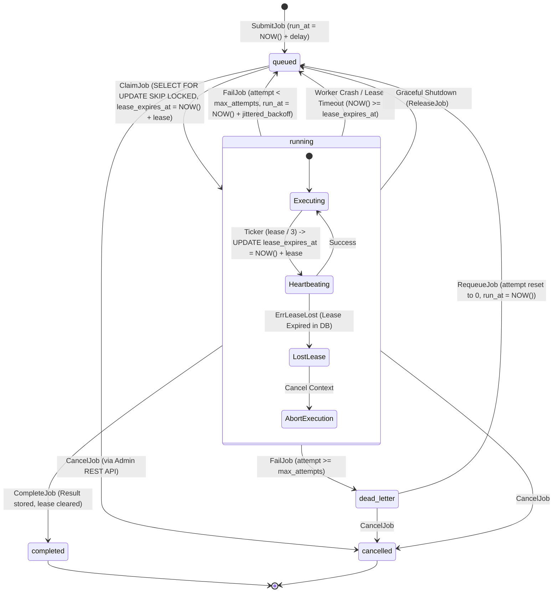

# Distributed Job Scheduler Architecture

## 1. System Topology & Architecture Diagram

```mermaid
graph TD
    Client[Admin / Client Application] -->|HTTP / REST| API[API Server / Chi Router]
    API -->|Submit / Cancel / Requeue| PG[(PostgreSQL 16 Cluster)]

    subgraph "Control Plane (Scheduler Instances)"
        S1[Scheduler Node 1] -.->|pg_try_advisory_lock| PG
        S2[Scheduler Node 2 (Standby)] -.->|pg_try_advisory_lock| PG
        S1 ===|Elected Leader| CronEngine[Cron & Delayed Engine]
        CronEngine -->|Enqueue Due Jobs with Idempotency Key| PG
    end

    subgraph "Execution Plane (Worker Fleet)"
        W1[Worker Node 1] -->|SELECT ... FOR UPDATE SKIP LOCKED| PG
        W2[Worker Node 2] -->|SELECT ... FOR UPDATE SKIP LOCKED| PG
        WN[Worker Node N] -->|SELECT ... FOR UPDATE SKIP LOCKED| PG
        
        W1 -.->|Heartbeat: UPDATE lease_expires_at| PG
        W2 -.->|Heartbeat: UPDATE lease_expires_at| PG
        
        W1 -->|Complete or Fail & Jittered Retry / DLQ| PG
        W2 -->|Complete or Fail & Jittered Retry / DLQ| PG
    end

    subgraph "Observability"
        API -->|Scrapes /metrics| Prom[Prometheus]
        W1 -->|OpenTelemetry Spans & Traces| OTel[OTel Collector / Jaeger]
        Prom --> Grafana[Grafana Dashboards]
    end
```

---

## 2. Job State Machine & Lifecycle



---

## 3. Deep-Dive: Core Engineering Invariants

### 3.1 Clock Skew & The Authoritative Database Clock
- **The Problem:** In multi-node clusters, worker host clocks can drift by dozens or hundreds of milliseconds (NTP skew, VM pauses, hypervisor migrations). If workers use local `time.Now()` to set or evaluate `lease_expires_at`, Worker A might consider its lease valid while Worker B (with clock 500ms ahead) considers it expired, leading to concurrent execution of the same job.
- **The Solution:** The scheduler treats PostgreSQL as the **single source of truth for time**. All lease evaluations, heartbeat extensions, and claim conditions use PostgreSQL's built-in `NOW()`. 
  - Claim query: `(state = 'queued' AND run_at <= NOW()) OR (state = 'running' AND lease_expires_at <= NOW())`
  - Heartbeat query: `lease_expires_at = NOW() + ($3 * INTERVAL '1 second') WHERE lease_expires_at > NOW()`
  Worker host clocks are never consulted for correctness-critical lease boundaries.

### 3.2 Race Conditions Between Claim, Heartbeat, and Lease Expiry
Consider three concurrent operations on the same job:
1. **Worker A** is running the job and sends a heartbeat.
2. **Worker B** executes the claim query looking for expired leases.
3. PostgreSQL evaluates the rows under row-level locking (`FOR UPDATE SKIP LOCKED`).
- If Worker A's heartbeat arrives before the lease expires, `UPDATE ... WHERE lease_expires_at > NOW()` succeeds. When Worker B scans the row, `lease_expires_at <= NOW()` is false; Worker B skips the row.
- If Worker A's heartbeat arrives after the lease expired and Worker B acquired the lock, Worker B updates `claimed_by = 'worker-B'`. When Worker A's heartbeat executes, `claimed_by = 'worker-A'` matches 0 rows! Worker A immediately receives `ErrLeaseLost`, aborts execution, and prevents zombie writes.

### 3.3 Transaction Boundaries & Result Atomicity
When a worker finishes executing a job:
1. If the job payload produced an external side-effect (e.g. sending an email or charging Stripe), the worker MUST pass an idempotency key to the external system.
2. The scheduler completes the job atomically in PostgreSQL:
   ```sql
   UPDATE jobs
   SET state = 'completed',
       result = $3,
       completed_at = NOW(),
       lease_expires_at = NULL,
       updated_at = NOW()
   WHERE id = $1
     AND claimed_by = $2
     AND state = 'running'
     AND lease_expires_at > NOW();
   ```
   If the worker crashed right after charging Stripe but before `CompleteJob` committed, the job will be reclaimed by another worker. Because the external system uses the job's `idempotency_key`, the duplicate charge is safely rejected.

### 3.4 Poison Jobs, Retry Storms & Full Jitter
- **Poison Jobs:** A job that deterministically crashes worker processes (e.g. invalid memory access or unhandled panic). Our Go worker wraps handlers in `recover()` and increments `attempt`. After `max_attempts` (default 3), the job transitions to `dead_letter` and halts retry loops.
- **Retry Storms & Thundering Herds:** If an upstream dependency (like an external API or database) goes down, hundreds of jobs fail simultaneously. If retries are scheduled with pure exponential backoff (`delay = 2^attempt`), all jobs retry at the exact same second, overwhelming the recovering dependency.
  We implement **Full Jitter** (Amazon Architecture pattern):
  $$\text{Cap} = \min(\text{MaxBackoff}, \text{BaseBackoff} \times 2^{\text{attempt}-1})$$
  $$\text{Delay} = \text{UniformRandom}(0, \text{Cap})$$
  This evenly spreads retry attempts over time, eliminating resonance peaks.
